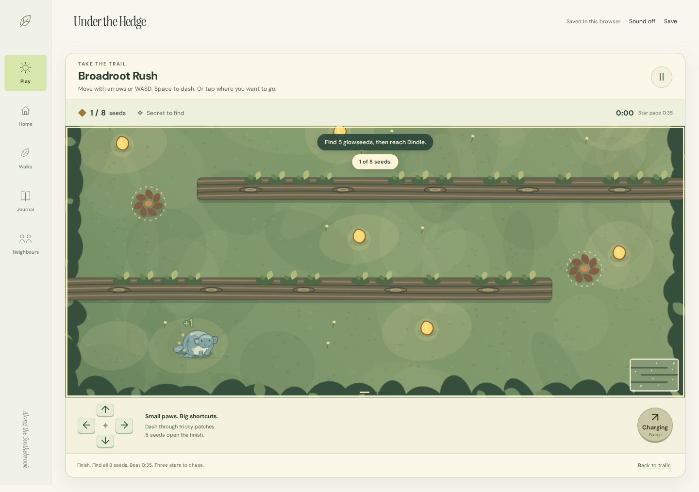

# Under the Hedge

A woodland adventure where you control your own Rillum: dash through roots, collect glowseeds, dodge moving obstacles and build a hideout with what you bring home. The new direction for the Petrealm project, using **Under the Hedge** as a working title.



Three playable trails introduce root mazes, brook crossings and pulsing shore ripples. Finish a trail to open the next. Find all eight seeds, discover its secret and beat your best time. Completed runs unlock decorations that visibly change your home.

There are no lives, countdown failures or missed-day penalties. A gentler setting gives more room to learn with the same rewards. Stories and quiet walks remain available alongside the action.

## Play locally

With Node.js 22.19+ or 24.11+ installed:

```sh
npm start
```

Open **http://localhost:4203**. No installation is needed to run the game. Use a current browser with JavaScript enabled; serve the app rather than opening its HTML file directly.

1. Choose a name, colour and marking, then press **Let’s play**. You go straight into Broadroot Rush.
2. Move with **WASD / arrows**, use **Space** to dash, or use the touch controls. Tap a destination to move there.
3. Collect at least five glowseeds and reach the neighbour at the glowing arch. Collect all eight and beat the trail time for three stars.
4. Open **Home → Build your hideout** to use your discoveries. Replay trails to improve your records or find their secrets.
5. Open **Journal**, visit neighbours or take a quiet walk when you feel like a slower visit.

Pause whenever you like. Navigating to another in-app page preserves your current run; reloading restarts an unfinished run while keeping completed rewards. Sound starts off and can be enabled in the header.

[What changed and how to play](docs/playable-adventures.md) · [World and story guide](docs/under-the-hedge.md)

## Keep your world

Your world saves in this browser. **Save → Download save** creates a portable JSON file. Restore it on another device, or keep your journal as an illustrated HTML document and your Rillum as an SVG portrait.

Imports keep the previous saved world as a recoverable backup. Unreadable saves are preserved. If storage is full or unavailable, the app keeps changes for the current visit and offers an export. Keep that file before closing the tab. Journal history retains the latest 100 events; export periodically if you want a longer archive.

Your earlier Petrealm save is separate and untouched by this world. Choose **Save → Visit your previous Petrealm world**, or open `/previous-world.html`. Its [guide and features](README.previous-world.md) remain available. The two worlds use different save files.

## Build and verify

```sh
npm ci
npm test
npm run build
npx playwright install chromium
npm run test:browser
```

The static build goes to `dist/`. `npm run preview` serves it at port 4203. Linux may need `npx playwright install --with-deps chromium`. Set `BROWSER_EXECUTABLE=/path/to/chrome` to use an installed Chromium browser.

Browser acceptance covers real movement and trail completion, touch controls, pausing, rewards, both earlier worlds, exports, save recovery and concurrent tabs. [Verification receipts](docs/verification.md) distinguish actual checks from planned work.

## Art and scope

The Rillum, Tuffet and Limmer families are original SVG artwork. Scenery was generated and refined with image generation; optional environmental audio was generated through ElevenLabs. Fonts are bundled under their OFL licences. There are no runtime external requests, accounts, tracking or paid services.

[Art production](docs/research/hedge-art-production.md) · [Audio production](docs/research/hedge-audio-production.md)

This is a local playable prototype: one playable family, three fixed adventure courses, one catchment and finite authored stories. Seasons, additional playable families and larger regional stories remain future work. The working title is not a claim of commercial name clearance. This change does not publish a new public release.
