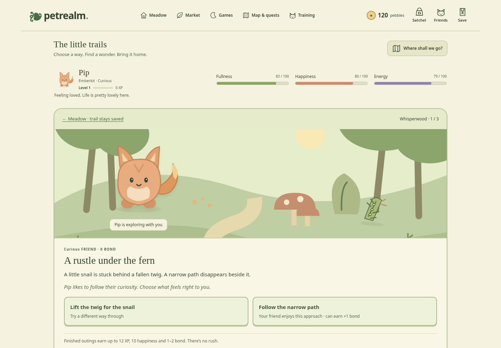

# Petrealm



[Try the live demo](https://tylerbuilds.github.io/petrealm/) · [Linux/macOS checks](https://github.com/tylerbuilds/petrealm/actions/workflows/verify.yml)

A little world of your own. Raise a family of original companions, dress them, complete quests, save your pebbles and take on friendly arena challenges. Take short choice-filled trails with each friend, discover original treasures and use them to make the meadow yours. Two interactive games reward timing and memory.

Petrealm is a dependency-free, local-first browser game. Its expanded release implements original local equivalents of pet care, collecting, shops, quests, customisation, banking and battles described by Neopets' public pages, using independently written rules, an original interface and original vector artwork. It is not affiliated with Neopets and does not include its code, species, artwork, names or fictional currency.

## Run on Linux or macOS

Install Node.js **22.19+ or 24.11+**, then:

```sh
git clone https://github.com/tylerbuilds/petrealm.git
cd petrealm
npm start
```

Open **http://localhost:4203** in a modern browser. No npm install is needed to run the app; it has no runtime dependencies. Browser verification uses Playwright as a development dependency. The same Node commands work on Linux and macOS. A modern browser with JavaScript, local storage and native `<dialog>` support is required. Open through the server, not directly as a `file://` document.

```sh
npm test           # Pure state, economy, time and import invariants
npm run build      # Produce the static site in dist/
npm run preview    # Serve dist/ on http://localhost:4203
```

The coordinating workflow records actual platform and browser checks in the research/runtime receipts. Portable code and a CI configuration do not on their own establish that a macOS run has passed.

## Play

[Start exploring: a short player guide](docs/explore-petrealm.md) · [Go on the little trails](docs/little-trails.md) · [What changed](CHANGELOG.md)

1. Meet the nine original companions. Pick a species and personality, give your friend a name, then press **Let’s go!** to enter Sunmeadow.
2. Share a **Berry treat** or **Acorn treat**, try **Ribbon play**, or take a **Cosy nap**. Your friend’s Fullness, Happiness and Energy update beside these actions.
3. Follow an illustrated meadow sign, or use the five labelled places at the top. **Map & quests** connects the meadow, market, glen, training grove and Pebble Keep. The notebook gives daily and lasting things to try.
4. Open **Satchel** or **Mail & gifts** for supplies, a daily 40-pebble letter and adventure keepsakes. **Friends** opens your family; **Try on an outfit** opens Dress up in the meadow.
5. Play two games in **Games** for pebbles, happiness and XP. Visit **Training** to practise or play saved turn-by-turn matches. A level 3 friend who has shared their own meal, ribbon play and nap can mark a first bloom in the meadow: a lasting new portrait and stronger future practice.
6. Follow the **Trails** sign for three short choices with your friend. Discover a keepsake, choose **Show in meadow**, and build bond to open the next path. Unfinished outings resume where you left them.
7. Use **Save** to download your world, move it to another device or restore a backup. Coming back to the same browser resumes your saved family.

[An earned discovery on a phone](docs/screenshots/discovery-mobile-0.6.png) · [Your field journal](docs/screenshots/journal-0.6.png) · [A keepsake in your meadow](docs/screenshots/meadow-0.6.png)

Care, games, quests and matches all use the established rules. [Meet every companion and see exact personality, favourite-food, training and bloom effects](docs/companions.md). [Game rules](docs/game-rules.md) document prices, caps and rewards.

Your game is saved in this browser, with no account, backend, network calls, telemetry or paid services. Clearing browser storage can remove your game; export a save first. Invalid stored saves open a recovery screen which keeps the original. Imports are strictly validated before replacing the current world; the previous save is retained as a local recovery backup. Storage failures produce a persistent unsaved indicator. Import is refused when a recovery backup cannot be written.

This is a single-player local game. Same-origin tabs serialise world mutations with Web Locks, or an IndexedDB transaction fallback, and read the latest saved state before each action. Importing or restoring a replacement world abandons an older unfinished game. Failed saves keep your in-memory progress available for export; a newer conflicting saved world blocks further mutations until you export or reload. It has no anti-cheat, server economy or clock authority; editing a local save or advancing the device clock is within the player's control.

## Delivered scope and parity gaps

A five-location illustrated map connects **Sunmeadow garden**, **Market lane**, **Pebble Keep**, **Starlight glen** and **Training grove**. Three original trail routes add rotating encounters, individual bond and a usable personality knack, nine discovered treasures and three saved meadow display spots. Outings reward actual completed choices without adding pebble payouts or daily resets. [Trail rules and older-save recovery](docs/little-trails.md). The release includes multiple independent companions, seven original supplies, visible wardrobes, bank transfers and original savings tiers, explicit daily interest, five/six daily quests with a rolling seven-day bonus, lasting quests, experience, three progressive arena rivals, two interactive games and a free Explorer Lodge mode. Nine original species have individual personalities, food preferences and care milestones, with eighteen young/bloomed portraits. [Meet the companions](docs/companions.md). Original inline SVG illustrations are in [`src/art.js`](src/art.js), [`src/creatures.js`](src/creatures.js) and [`src/world-art.js`](src/world-art.js); immutable game rules are in [`src/model.js`](src/model.js).

Version 3 saves strictly migrate accepted version 1 and 2 worlds. Earlier world fields stay intact; each companion starts with zero trail bond, and the new discovery journal starts empty. Version-specific originals are retained before automatic overwrites. If the protected version 2 original belongs to a different world, Save provides an exact download and explicit safe upgrade path while retaining earlier backups. Existing pets, stats, money, supplies, counts, achievements and daily/game histories survive migration. Older version 2 files are also accepted: their original bank balance and already paid daily feast remain intact. Earlier version 2 bank, quest-log and per-companion personality/journey fields remain validated optional extensions of that older schema; migration does not invent historical daily completion, weekly progress or individual care milestones. Companions without a recorded personality default to Steady; existing personalities and original fields stay intact. All write paths retain the multi-tab mutex and recovery safeguards.

The all-tier source comparison retains the dated 0.3 audit. The [current companion guide](docs/companions.md) describes the new animals, monsters and growth system without claiming the full online service catalogue.

The [free and Premium parity ledger](docs/parity-ledger.md) and [all-tier source comparison](docs/research/feature-comparison.md) record delivered behaviour, sources and remaining or unknown features. This is a playable local reconstruction of selected feature categories. It does not provide full Neopets service parity: online accounts, player shops, trading, auctions, PvP, forums, remote sync, the large item/species/game catalogue and many specific Premium perks remain absent. The daily Lodge parcel, earned expansion prices, bank tiers/rates and quest rewards are original choices; no subscription or paid entitlement service is claimed. Resets use UTC, while the target uses NST. There are no missed-day interest accruals, rotating quest pools, rerolls or streak-save tickets. [Bank and Quest Log research](docs/research/bank-quests-analogue.md) separates official facts from these local rules.

Game balance, quest/battle rules, migration and storage behaviour are documented in [`docs/game-rules.md`](docs/game-rules.md). The initial public-surface investigation is retained in [`docs/research/feature-map.md`](docs/research/feature-map.md). Research uses the [REA](https://github.com/morluto/rea) toolkit starred by tylerbuilds; sanitised capture provenance and denied-access limits are in [`rea-provenance.md`](docs/research/rea-provenance.md) and [`rea-findings.json`](docs/research/rea-findings.json).

## Development

- `src/model.js`: immutable rules, validation and JSON import/export. Every action returns a new state or throws a helpful error.
- `src/app.js`: coordinated local persistence, migration, accessible dialogs, navigation and two interactive games.
- `src/views.js`, `src/trail-views.js`: connected care, shop, bank, quest, Lodge, arena, trail choices and discovery journal interfaces.
- `src/trails.js`, `src/trail-art.js`: original encounter stories, discoveries and illustrated trail scenery.
- `src/art.js`, `src/creatures.js`, `src/world-art.js`: original companions, growth forms, wardrobe, illustrated places, world guides and game controls.
- `tests/model.test.js`, `tests/parity-model.test.js`, `tests/bank-quest-log.test.js`, `tests/companions.test.js`, `tests/trails.test.js`, `tests/trail-ui.test.js`: meaningful migration, economy, resource, time and reward invariants using Node's built-in test runner.
- `scripts/serve.mjs`, `scripts/build.mjs`: dependency-free development and static build utilities.

Changes should preserve saved worlds, keep all assets original, and disclose any new network or account behaviour before introducing it. Contributions and forks are welcome under the [MIT licence](LICENSE).

## Browser verification

The runtime has no package dependencies. To run the development browser checks, install the pinned tools and Chromium:

```sh
npm ci
npx playwright install chromium
npm run build
npm run test:browser
```

Linux runners may need `npx playwright install --with-deps chromium` for browser system libraries. `BROWSER_EXECUTABLE=/path/to/chrome npm run test:browser` uses an existing browser. The GitHub workflow runs model tests, a static build and real browser edit/persistence/export checks on both Ubuntu and macOS, then publishes the static demo only after both pass.

[REA investigation provenance](docs/research/rea-provenance.md) records public observations, receipt digests and explicit research limits.
