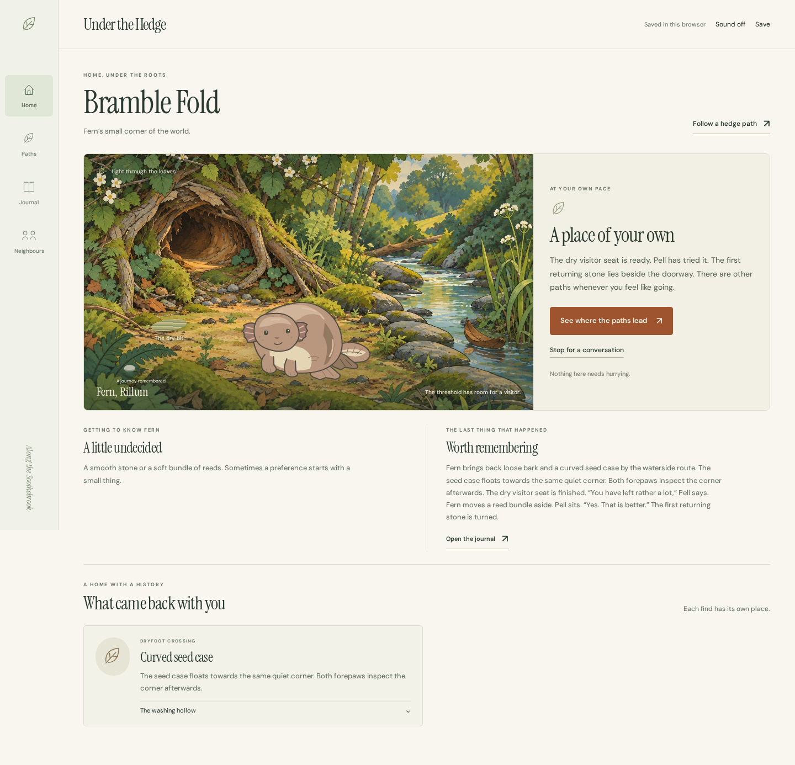

# Under the Hedge

An illustrated browser world about one particular small creature, the paths it learns and the things it brings home. The new direction for the Petrealm project, using **Under the Hedge** as a working title.



Meet Fen, or name your own Rillum. Make room for Pell at a wet doorway. Follow root paths through Broadroot Wood, find your way over Dryfoot Crossing and discover why the far shore of Alderwater glows.

The first playable contains a complete opening, three routes, four neighbours, changing return stories and a mystery with an answer. Repeated experiences reveal specific preferences for water, hollow sounds or sheltered places. Objects and journal entries remember what actually happened.

No care meters, currency, streaks or penalties for time away. Your companion is safe, and every unfinished moment waits.

## Play locally

With Node.js 22.19+ or 24.11+ installed:

```sh
npm start
```

Open **http://localhost:4203**. No installation is needed to run the game. Use a current browser with JavaScript enabled; serve the app rather than opening its HTML file directly.

1. Choose a name, colour and marking.
2. Make a visiting place through the four short opening choices.
3. Open **Paths** and choose an outing and weather. The first outing takes 30 seconds; later outings take 2–5 minutes. A finished journey never expires.
4. Come home to hear what happened. Place finds, visit neighbours and follow the light across Alderwater.
5. Open **Journal** to revisit your actual experiences. **Sound** enables optional brook ambience; it starts off.

[Player and design guide](docs/under-the-hedge.md) · [Phone view](docs/screenshots/hedge-mobile.png)

## Keep your world

Your world saves in this browser. **Save → Download save** creates a portable JSON file. Restore it on another device, or keep your journal as an illustrated HTML document and your Rillum as an SVG portrait.

Imports keep the previous saved world as a recoverable backup. Unreadable saves are preserved. If storage is full or unavailable, the app keeps changes for the current visit and offers an export. Keep that file before closing the tab. Journal history retains the latest 100 events; export periodically if you want a longer archive.

Your earlier Petrealm save is separate and untouched by this world. Choose **Save → Visit your previous Petrealm world**, or open `/previous-world.html`. Its [guide and features](README.previous-world.md) remain available. The two worlds use different save files.

## Build and verify

```sh
npm ci
npm test
npm run build
npx playwright install chromium
npm run test:browser
```

The static build goes to `dist/`. `npm run preview` serves it at port 4203. Linux may need `npx playwright install --with-deps chromium`. Set `BROWSER_EXECUTABLE=/path/to/chrome` to use an installed Chromium browser.

Browser acceptance covers both worlds, full story completion, mobile layouts, optional audio, exports, save recovery and concurrent tabs. [Verification receipts](docs/verification.md) distinguish actual checks from planned work.

## Art and scope

The Rillum, Tuffet and Limmer families are original SVG artwork. Scenery was generated and refined with image generation; optional environmental audio was generated through ElevenLabs. Fonts are bundled under their OFL licences. There are no runtime external requests, accounts, tracking or paid services.

[Art production](docs/research/hedge-art-production.md) · [Audio production](docs/research/hedge-audio-production.md)

This is a local first playable: one playable family, one catchment and finite authored stories. Seasons, additional playable families and larger regional stories remain future work. The working title is not a claim of commercial name clearance. This change does not publish a new public release.
