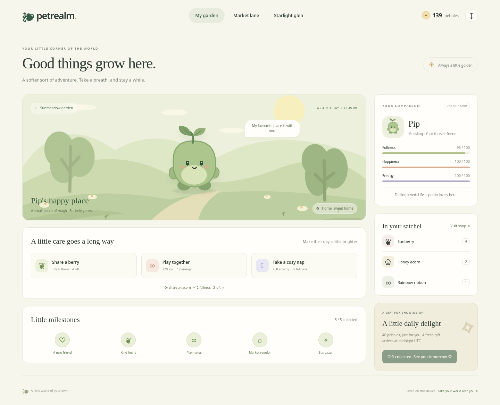

# Petrealm



[Try the live demo](https://tylerbuilds.github.io/petrealm/) · [Linux/macOS checks](https://github.com/tylerbuilds/petrealm/actions/workflows/verify.yml)

A little world of your own. Adopt an original companion, care for them in a quiet garden, shop for treats and catch fireflies beneath the stars.

Petrealm is a dependency-free, local-first browser game. Its initial release explores the pet-care, collecting, shop and mini-game loop described by Neopets' public pages, using independently written rules, an original interface and original vector artwork. It is not affiliated with Neopets and does not include its code, species, artwork, names or fictional currency.

## Run on Linux or macOS

Install Node.js **22.19+ or 24.11+**, then:

```sh
git clone https://github.com/tylerbuilds/petrealm.git
cd petrealm
npm start
```

Open **http://localhost:4203** in a modern browser. No npm install is needed to run the app; it has no runtime dependencies. Browser verification uses Playwright as a development dependency. The same Node commands work on Linux and macOS. A modern browser with JavaScript, local storage and native `<dialog>` support is required. Open through the server, not directly as a `file://` document.

```sh
npm test           # Pure state, economy, time and import invariants
npm run build      # Produce the static site in dist/
npm run preview    # Serve dist/ on http://localhost:4203
```

The coordinating workflow records actual platform and browser checks in the research/runtime receipts. Portable code and a CI configuration do not on their own establish that a macOS run has passed.

## Play

1. Choose a **Mossling**, **Emberkit** or **Moonfin**, then name your friend.
2. Keep their fullness, happiness and energy healthy with snacks, play and rest.
3. Spend **pebbles** at Market lane. Food is consumed; the rainbow ribbon is reusable.
4. Collect a 40-pebble gift once per UTC day.
5. Visit Starlight glen. Click **Catch** or press **Space** as the moving firefly crosses the golden centre. Ten catches or thirty seconds finish the round. Timing determines your score and reward.
6. Collect little milestones and use the save button to export a backup or move your world between devices.

Your game is saved in this browser, with no account, backend, network calls, telemetry or paid services. Clearing browser storage can remove your game; export a save first. Invalid stored saves open a recovery screen which keeps the original. Imports are strictly validated before replacing the current world; the previous save is retained as a local recovery backup. Storage failures produce a persistent unsaved indicator. Import is refused when a recovery backup cannot be written.

This is a single-player local game. Same-origin tabs serialise world mutations with Web Locks, or an IndexedDB transaction fallback, and read the latest saved state before each action. Importing or restoring a replacement world abandons an older unfinished game. Failed saves keep your in-memory progress available for export; a newer conflicting saved world blocks further mutations until you export or reload. It has no anti-cheat, server economy or clock authority; editing a local save or advancing the device clock is within the player's control.

## Initial scope

The three areas are **Sunmeadow garden** (pet care), **Market lane** (fixed-price supplies) and **Starlight glen** (a timing mini-game). All illustrations are original inline SVG in [`src/art.js`](src/art.js); all game rules are in [`src/model.js`](src/model.js), consumed by the browser application and tested directly.

The release supports one companion per save, three supplies, eight model achievements (five displayed as the main milestone collection), bounded offline stat decay and validated version 1 save files. There is no multiplayer, trading, combat, wardrobe, player-owned shop, quests, mobile app or remote synchronisation. Those are roadmap candidates, not implemented features.

Research observations, inferences and gaps are recorded in [`docs/research/feature-map.md`](docs/research/feature-map.md). Game balance and save behaviour are documented in [`docs/game-rules.md`](docs/game-rules.md). The investigation uses the [REA](https://github.com/morluto/rea) toolkit starred by tylerbuilds. Sanitised capture provenance and access limits are in [`docs/research/rea-provenance.md`](docs/research/rea-provenance.md) and [`rea-findings.json`](docs/research/rea-findings.json).

## Development

- `src/model.js`: immutable rules, validation and JSON import/export. Every action returns a new state or throws a helpful error.
- `src/app.js`: local persistence, accessible dialogs, navigation and the interactive mini-game.
- `src/art.js`: original creature, landscape and shop vectors.
- `tests/model.test.js`: meaningful invariants using Node's built-in test runner.
- `scripts/serve.mjs`, `scripts/build.mjs`: dependency-free development and static build utilities.

Changes should preserve saved worlds, keep all assets original, and disclose any new network or account behaviour before introducing it. Contributions and forks are welcome under the [MIT licence](LICENSE).

## Browser verification

The runtime has no package dependencies. To run the development browser checks, install the pinned tools and Chromium:

```sh
npm ci
npx playwright install chromium
npm run build
npm run test:browser
```

Linux runners may need `npx playwright install --with-deps chromium` for browser system libraries. `BROWSER_EXECUTABLE=/path/to/chrome npm run test:browser` uses an existing browser. The GitHub workflow runs model tests, a static build and real browser edit/persistence/export checks on both Ubuntu and macOS, then publishes the static demo only after both pass.

[REA investigation provenance](docs/research/rea-provenance.md) records public observations, receipt digests and explicit research limits.
