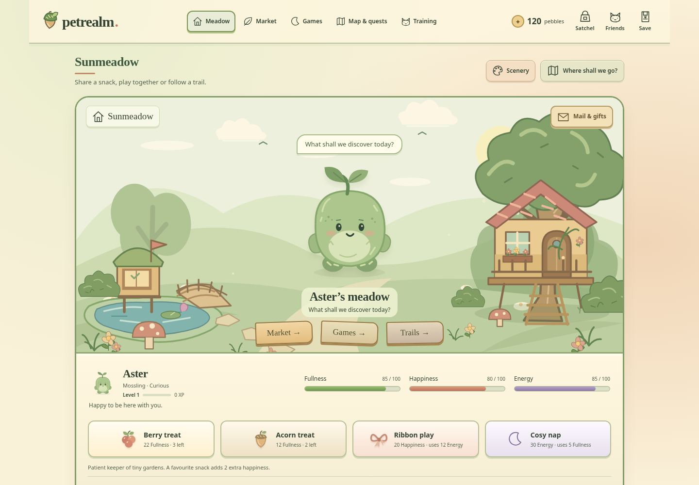

# Petrealm



[On a phone](docs/screenshots/world-art-mobile-0.7.png) · [Explore the map](docs/screenshots/world-map-0.7.png)

[Play Petrealm](https://tylerbuilds.github.io/petrealm/) · [Player guide](docs/explore-petrealm.md)

Petrealm is a browser game about looking after animal and monster friends. Choose a companion, share snacks, play games and explore together. Bring treasures home from the little trails and find somewhere for them in your meadow.

There are nine original companions to meet. Each keeps their own personality, outfit, experience and bond with you. Care, games and practice help them bloom into a new look. Exploring together builds bond and opens more paths.

## Start exploring

1. Choose a friend and personality, give them a name, then press **Let’s go!**.
2. In the meadow, share a treat, play with the ribbon or have a cosy nap. **Fullness**, **Happiness** and **Energy** show how your friend feels.
3. Follow a **Trails** sign. Make three choices, find a treasure, then choose **Show in meadow** to bring it home. You can visit another place and return to your unfinished outing later.
4. Visit **Games** to catch fireflies or find matching flowers. Earn pebbles for snacks, outfits and practice.
5. Open **Map & quests** for more places and things to try, or **Training** to practise and play a friendly match.

**Satchel** holds your supplies and Mallow’s daily gift. **Friends** lets you choose who comes along. **Save** downloads a copy of your world or restores one from another device.

**Scenery** lets you choose your own meadow and arrival pictures. They stay in this browser, with fit and clear controls; world save files keep your game progress separately.

[The little trails](docs/little-trails.md) explains choices, costs and finds. [Meet the companions](docs/companions.md) explains personalities, favourite snacks and blooming.

## What’s in the world?

| Place | Things to do |
| --- | --- |
| Sunmeadow | Care for friends, try on outfits, bloom and show three trail treasures. |
| Market lane | Buy seven kinds of supplies and put pebbles away in the Pebble Keep. |
| Starlight glen | Play Firefly flight and Memory meadow. |
| Map & quests | Visit each place, try daily and lasting quests, or join the free Explorer Lodge for more friend spaces. |
| Training grove | Practise and play saved turn-by-turn matches against three rivals. |
| The little trails | Explore three routes with changing stories, find nine treasures and unlock each friend’s special knack. |

Games still give Happiness and XP after you’ve earned the day’s game pebbles. Bank interest, mail and daily quest gifts reset at midnight UTC. The [game rules](docs/game-rules.md) give every price, reward and limit.

[A discovery on a phone](docs/screenshots/discovery-mobile-0.6.1.png) · [The field journal](docs/screenshots/journal-0.6.png) · [A treasure in the meadow](docs/screenshots/meadow-0.6.png)

## Keep your world

Your world saves in this browser. There’s no account, subscription, cloud save or tracking. Before clearing browser storage or moving to another device, choose **Save → Download save file**.

Restoring a file replaces the current world and keeps the previous save as a backup. If saving fails, the screen tells you and you can download your unsaved progress. If another tab saves a different world, download your changes before reloading. The [player guide](docs/explore-petrealm.md) covers saving; [older-save help](docs/little-trails.md#older-worlds) explains upgrades.

## Run on Linux or macOS

Install Node.js **22.19+ or 24.11+**, then run:

```sh
git clone https://github.com/tylerbuilds/petrealm.git
cd petrealm
npm start
```

Open **http://localhost:4203**. Running the game needs no npm install. Use a current browser with JavaScript and local storage, and open the served page rather than the HTML file itself.

## Build and check a change

```sh
npm test
npm run build
npm run preview
```

The build goes into `dist/`; preview serves it at **http://localhost:4203**. To run the browser checks:

```sh
npm ci
npx playwright install chromium
npm run build
npm run test:browser
```

Linux may need `npx playwright install --with-deps chromium`. To use an installed Chrome, set `BROWSER_EXECUTABLE=/path/to/chrome` when running `npm run test:browser`.

The [Linux/macOS workflow](https://github.com/tylerbuilds/petrealm/actions/workflows/verify.yml) runs tests, builds and browser checks before publishing the demo. [Recorded checks](docs/verification.md) explain what was tested for each release. See [contributing](CONTRIBUTING.md) for working on the game.

## About the project

Petrealm’s code, creatures, stories and SVG artwork are original and released under the [MIT licence](LICENSE). Public Neopets pages helped inform some feature ideas. Petrealm is independent and isn’t affiliated with Neopets.

The meadow, market and trails have their own illustrated scenery, with separate compositions for phones. [Drawing Petrealm](docs/world-art.md) explains the palette and where to find the artwork.

This is a local, single-player game. Online accounts, trading, player shops, auctions and social features are outside its scope. The [feature comparison](docs/parity-ledger.md) keeps the detailed differences and links to sources. [Game rules](docs/game-rules.md) also cover save formats, recovery and how multiple tabs share a world.
